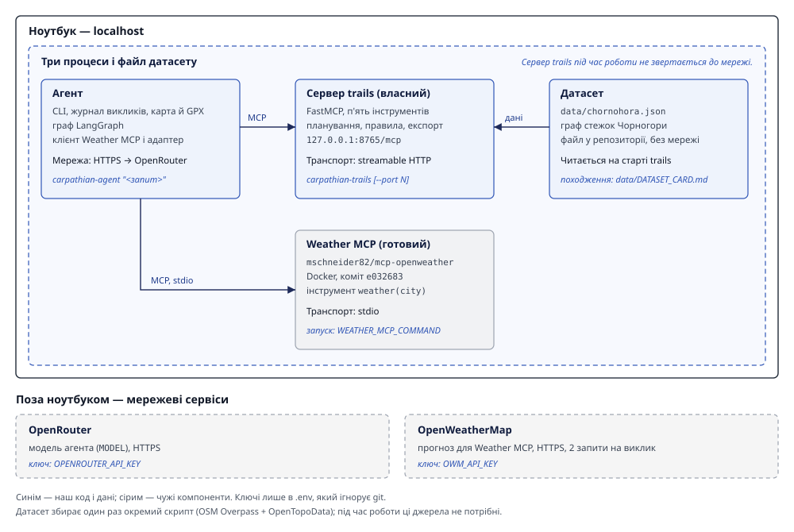
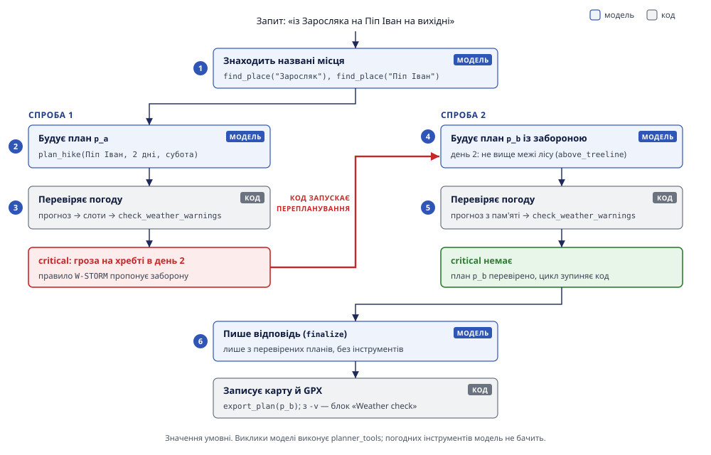
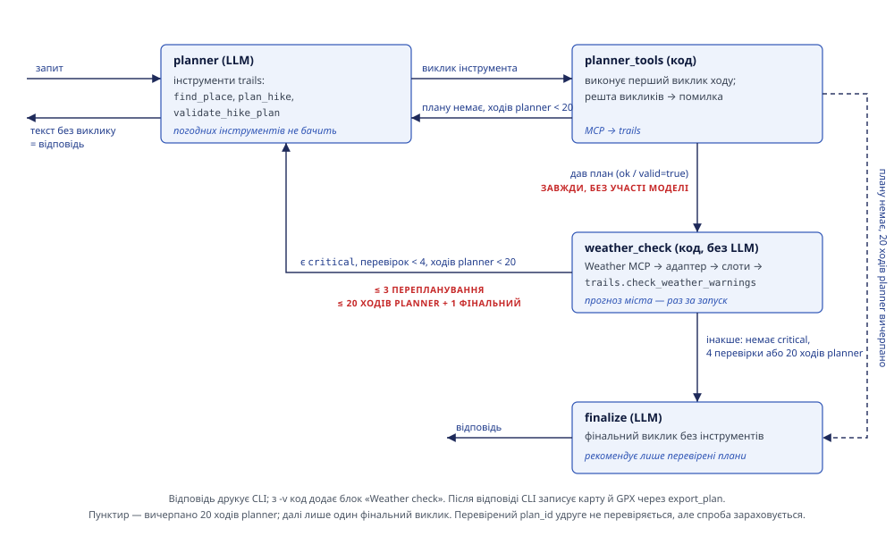

# Архітектура: планувальник походів Чорногорою

Що збудовано, з яких частин і чому так. Контракти інструментів — у [`contracts.md`](contracts.md), сценарій захисту — у [`defense.md`](defense.md), встановлення й запуск — у [`README.md`](../README.md). Точні вимоги й граничні випадки описано в специфікаціях (`openspec/changes/<change>/specs/`). Обсяг визначає рубрика лабораторної (`docs/AgenticAI_Lab1.md`).

## 0. Огляд

### 0.1. Мета

**Проблема.** Маршрут у горах складають за картою, а погоду перевіряють окремо. Через це план, придатний за часом і відстанню, може вивести на відкритий хребет у грозу чи сніг.

**Рішення.** Агент для лабораторної «MCP Integration» планує похід масивом Чорногора на 1–5 днів, перевіряє кожен план за актуальним прогнозом і перепланує, якщо погода критична. Він має два MCP-з'єднання:

- **власний сервер `trails`**: граф стежок із локального датасету, планування, перевірка маршруту, погодні правила й експорт плану для карти;
- **готовий Weather MCP** (`mschneider82/mcp-openweather`): актуальний прогноз OpenWeatherMap.

**Результат.** Користувач отримує план, карту й GPX, а з `-v` — ще й правила та рядки прогнозу, які підтверджують висновки. Промпт забороняє агентові називати маршрут «безпечним»: перевіряються лише окремі погодні ризики (розділ 4).

### 0.2. Компоненти й процеси

*Рис. 1. Три окремі процеси на ноутбуці й два мережеві сервіси поза ним. Сервер `trails` не звертається до мережі й не знає поточної дати.*

### 0.3. Приклад одного запуску

Значення умовні. Запит: «із Заросляка на Піп Іван на вихідні».

*Рис. 2. Один запуск із переплануванням. Перевірку погоди й рішення перепланувати запускає код; модель лише будує новий план із забороною, яку запропонувала перевірка.*

### 0.4. Хто що вирішує

| Модель | Код |
|---|---|
| розуміє запит і знаходить названі місця | перевіряє на погоду кожен план, перш ніж його побачить користувач |
| вибирає кількість днів, дату і що робити: будувати план (`plan_hike`) чи перевірити маршрут користувача (`validate_hike_plan`) | сам розбирає текст прогнозу на записи по 3 години (слоти); модель чисел прогнозу не переписує |
| перепланує за інструкцією промпту: передає в `plan_hike` заборону, яку запропонувала перевірка; якщо плану немає — змінює лише власне припущення (дату) або пояснює, що в умовах користувача плану немає | вирішує, чи перепланувати: лише за `critical` і поки є бюджет; що саме заборонити, обчислює правило `W-*` на сервері |
| пише відповідь мовою користувача | обмежує цикл: не більше 3 перепланувань; план, який уже перевіряли, вдруге не перевіряється, але спроба зараховується |
| | друкує блок «Weather check» з правилами й рядками прогнозу (з `-v`), записує карту й GPX |

Скільки буде викликів і яких, залежить від результатів інструментів (розділ 5.3).

### 0.5. Терміни

| Термін | Значення |
|---|---|
| **Хід моделі** | Один виклик LLM у вузлі `planner`: модель отримує історію розмови й інструменти та або просить викликати інструмент, або пише текст. Фінальний виклик у `finalize` — окремий, без інструментів, і в ліміт ходів не входить. |
| **MCP-клієнт** | Програма, що підключається до MCP-сервера й викликає його інструменти. Для обох серверів проєкту це агент. |
| **Вузол** | Точка графа стежок: гірська вершина, перехрестя стежок, притулок, стоянка або село. |
| **Сегмент** | Ділянка стежки між двома сусідніми вузлами. |
| **Місце ночівлі** | Вузол, де можна заночувати: притулок, село, а в режимі намету ще й стоянка. |
| **Етап** | Один день походу в плані: шлях, кілометри, набір висоти, час. |
| **План** | Похід, розбитий на етапи. Має ідентифікатор `plan_id`. |
| **Сховище планів** | Пам'ять сервера `trails`, де лежать плани, які він видав. Завдяки йому інструменту досить передати `plan_id`, а не весь план. |
| **Місто прогнозу** | Населений пункт у долині, для якого запитується прогноз. Кожен вузол має найближче таке місто. Місто, а не координати вершини, бо інструмент `weather` приймає лише назву міста ([контракти, 3.1](contracts.md)). |
| **Слот прогнозу** | Один запис прогнозу на 3 години: місто, час початку, умова (`Rain`, `Snow`, …) і температура. |
| **Вікно перевірки** (`check_window`) | Світлий час дня етапу. Для цього проміжку перевірці погоди потрібен прогноз. |
| **Покриття** | Чи вистачає слотів прогнозу на все вікно перевірки дня: `full`, `partial` або `none` (контракти, 3.4). |
| **Правила `R-*`** | Правила допустимості маршруту (R — route): чи можна так іти (контракти, 2.2). |
| **Правила `W-*`** | Погодні правила (W — weather): чи небезпечна погода для етапу (контракти, 3.5). |
| **Знахідка** | Спрацювання погодного правила в конкретний день, разом зі слотами, які його спричинили. |
| **Критична погода** (`critical`) | Гроза на етапі вище межі лісу або сніг на відкритому хребті. Лише вона запускає перепланування. |
| **Заборона** (`day_constraints`; у специфікаціях — «обмеження по днях») | Вимога до `plan_hike`: у вказаний день не йти вище межі лісу або відкритим хребтом (контракти, 2.3). |
| **Бюджет** | Обмеження циклу агента: не більше 3 перепланувань, 20 ходів `planner` і одного фінального виклику (розділ 3). |
| **Адаптер** | Функція, що перетворює текст прогнозу від Weather MCP на слоти прогнозу. |
| **Вузол графа агента** | Крок агента в LangGraph (розділ 3). Не плутати з вузлом графа стежок. |

## 1. Обсяг

- масив Чорногора; дані — локальний файл у репозиторії;
- похід на 1–5 днів. `days` — точна кількість днів, і кожного дня є перехід. Між днями — ночівля в притулку, селі або (в режимі намету) на стоянці; одноденний похід ночівлі не потребує;
- актуальний прогноз через Weather MCP і перепланування, якщо погода критична;
- п'ять інструментів `trails`: `find_place`, `plan_hike`, `validate_hike_plan`, `check_weather_warnings`, `export_plan`;
- CLI: один запит на запуск; `--list-tools` показує сервери й інструменти; карта й GPX плану; журнал викликів з `-v`.

## 2. Код

Команди запуску й змінні оточення — у README. Код поділено так:

- увесь код в одному пакеті `carpathian_planner` у `src/`: після встановлення модулі не стають глобальними іменами на кшталт `agent`, а тести не імпортують код повз встановлений пакет;
- `trails/`: доменні модулі (датасет, час ходу, маршрути, правила `R-*`, планувальник, правила `W-*`, експорт) окремо від `server.py` і `schemas.py`. Логіку тестують звичайні виклики функцій, без запуску сервера; доменні модулі не знають про MCP, мережу й поточну дату;
- `agent/`: вузли графа — звичайні функції, а модель та інструменти вони отримують через `runtime.context` (`AgentContext`), тож граф не знає ні про MCP, ні про OpenRouter, і тести підставляють фейки;
- `weather_client.py` окремо: лише він залежить від формату чужого сервера, а користуються ним і агент, і діагностична команда `carpathian-weather-probe`;
- `scripts/build_dataset.py` збирає датасет з OSM і OpenTopoData; запускається вручну й потребує мережі, сервер — ні.

Стек: Python 3.12, `fastmcp`, `langgraph`, `langchain-core`, `langchain-mcp-adapters`, `langchain-openai`, `pydantic`, `python-dotenv`; `httpx` — лише для `scripts/build_dataset.py`; `pytest` — dev-залежність.

## 3. Агент

**Що це.** Програма, яка з'єднує модель з обома серверами й веде її від запиту до відповіді. Побудована як граф LangGraph з чотирьох кроків (вузлів графа агента):

| Крок | Хто | Що робить |
|---|---|---|
| `planner` | модель | один хід моделі: викликати інструмент `trails` або написати відповідь |
| `planner_tools` | код | виконує виклик, який попросила модель, і запам'ятовує план, якщо його отримано |
| `weather_check` | код | прогноз для міст плану → слоти → `check_weather_warnings` |
| `finalize` | модель | фінальна відповідь, лише текст, коли цикл зупинив код |

*Рис. 3. Граф агента. Кожна стрілка підписана умовою переходу; пунктир — вичерпано 20 ходів `planner`.*

**Переходи між кроками** (`agent/graph.py`):
- `planner` попросив інструмент → `planner_tools`. `planner` написав текст → це і є відповідь: плану немає або останній план уже перевірено.
- `planner_tools`: виклик дав план (`plan_hike` зі `status="ok"` або `validate_hike_plan` з `valid=true`) → `weather_check`, завжди. Плану немає → `planner`, а якщо 20 ходів `planner` вичерпано — `finalize`.
- `weather_check`: є `critical` і перевірок погоди менше 4 → `planner` (або `finalize`, якщо вичерпано 20 ходів `planner`); інакше → `finalize`.

`finalize` потрібен, коли цикл зупиняє код, а не модель: модель викликають востаннє, уже без інструментів, щоб вона написала відповідь з перевірених планів.

**Правила роботи:**

- **Інструменти моделі.** Модель бачить лише `find_place`, `plan_hike` і `validate_hike_plan`. `weather`, `check_weather_warnings` і `export_plan` викликає код.
- **Один виклик інструмента за хід моделі.** Якщо модель просить кілька одразу, виконується перший, а решта отримує відповідь-помилку. Так за хід з'являється щонайбільше один план, і жоден не оминає перевірку погоди. Ціна — повільніший цикл.
- **`weather_check`** бере прогноз для кожного міста прогнозу плану (один раз за запуск, далі з пам'яті: кожен виклик — запуск контейнера і два запити до OWM) і викликає `check_weather_warnings`. Якщо прогноз недоступний, перевірка отримує порожній список слотів і дає оцінку `unknown`.
- **Обхід (`DETOUR`).** Якщо план прийшов з попередженням `DETOUR` (заборони через погоду зробили похід щонайменше в 1,5 раза довшим, контракти 2.3), а план без заборон у цьому запуску ще не перевіряли, `weather_check` отримує його через `export_plan` і перевіряє теж. Ця перевірка не витрачає бюджету й не впливає на перехід. Модель отримує запис `detour`: км, години й етапи звичайного маршруту з мітками, а також його погодні знахідки зі слотами-доказами, бо цей план вона в результатах інструментів не бачила. У відповіді вона подає два варіанти, не рекомендуючи жодного.
- **Бюджет:** не більше 3 перепланувань (тобто 4 перевірок погоди) і не більше 20 ходів `planner`, після яких іде один фінальний виклик `finalize`: разом до 21 виклику LLM. Хід рахується й тоді, коли виклик не виконано: це зайвий виклик у тому самому ході або інструмент, недоступний моделі. План з `plan_id`, який уже перевіряли, вдруге не перевіряється, але спроба зараховується до бюджету, а модель отримує попередній результат.
- **Типові припущення.** Якщо дату не названо — старт завтра (за київським часом); підготовка `medium`; ночівля `hut`. Відповідь ці припущення називає. Те, що користувач задав явно, під час перепланування не змінюється.
- **Підключення до серверів незалежні.** Без `trails` CLI завершується з кодом 1. Без Weather MCP агент працює далі й показує статус `weather: UNAVAILABLE (<причина>)`.
- **CLI.** Один запит на запуск. `--list-tools` показує обидва сервери й шість інструментів (п'ять `trails` і `weather`). Коди виходу: 0 — є відповідь (також без Weather MCP і коли карту не вдалося записати), 1 — немає `trails` чи його інструментів, ключа або моделі, 2 — помилка аргументів.
- **Докладність виводу.** Без прапорців stdout містить лише відповідь моделі й шляхи до файлів карти, а stderr — лише збої (`UNAVAILABLE`, помилки). `-v` додає рядки статусу серверів, журнал викликів і блок «Weather check»; `-vv` — ще й повні результати інструментів, зокрема всі слоти прогнозу.
- **Журнал викликів** (з `-v`) — у stderr, рядок на кожен виклик: `[<server>] <tool> caller=<model|code> args=<json> -> <status>`. `caller=code` мають `weather`, `check_weather_warnings` і `export_plan`; замість слотів друкується їхня кількість. Статуси: `ok`, `error <CODE>`, `rejected` (виклик не виконано), `cached` (прогноз уже є), `skipped` (Weather MCP недоступний), `unavailable` / `invalid_response`. Ключі в журналі замасковано.
- **Модель.** `MODEL=openrouter:<id>`, типово `openrouter:anthropic/claude-haiku-5.5`, клієнт `ChatOpenAI` з адресою OpenRouter. Параметри вибірки (`temperature` та інші) не передаються: типова модель відхиляє їх нетипові значення.
- **Відповідь.** Текст моделі мовою користувача, без `plan_id`, `node_id` і кодів правил: місця названо мітками, погодні ризики — словами з містом, часом і умовою. Діалогу немає, тому питань відповідь не ставить: коли запит неповний або плану в заданих умовах немає, вона перелічує варіанти, кожен з готовим запитом для нового запуску. Про вітер модель не пише: примітку про нього код прибирає з результату перевірки для моделі. Блок «Weather check» друкує код: правила, що спрацювали, слоти-докази, покриття днів, статус прогнозу й примітка про вітер.
- **Файли карти.** Після відповіді CLI бере останній перевірений план (а за `DETOUR` — і план без заборон), отримує їх через `export_plan` і записує в теку `--out` (типово `plans/`):
  - `<plan_id>.gpx` — GPX 1.1 для навігаторів (Mapy.com, OsmAnd, Gaia GPS): трек на день, точки старту, ночівель і фінішу;
  - `<plan_id>.html` — одна автономна сторінка: топографічна карта (Leaflet і OpenTopoMap з інтернету), дні з місцями, км, набором і годинами, погода українською за київським часом, кнопка GPX; за `DETOUR` — два варіанти з перемикачем.

  Українські мітки, фрази погоди й час готує Python, а скрипт сторінки лише розкладає їх, тому вміст сторінки перевіряють тести без браузера. Якщо вивантаження не вдалося, у stderr з'являється одне речення з причиною, а код виходу лишається 0.

Повні вимоги описує spec `hike-agent`.

## 4. Відомі обмеження

- **Вітер і кількість опадів не оцінюються:** у прогнозі Weather MCP їх немає; слабкий і зливовий дощ рівноцінні.
- **Прогноз долини для хребта.** На етап береться одне місто прогнозу; далі 15 км результат має примітку. Поправка 6.5 °C/км відповідає стандартній атмосфері, тому за інверсії (коли на хребті тепліше, ніж у долині) правила холоду й снігу спрацьовують зайво. Межа дощ/сніг 0 °C — спрощення: мокрий сніг між 0 і +2 °C дасть лише `W-RAIN`.
- **Горизонт прогнозу ~5 днів.** Дальші дні отримують `coverage="none"` і `unknown`; сьогоднішній день майже завжди `partial`, бо ранкові слоти минули.
- **Weather MCP приховує помилки OWM.** Невідоме місто, поганий ключ і збій мережі дають однаковий `WEATHER_INVALID_RESPONSE`; причину встановити неможливо.
- **Сховище планів у пам'яті сервера:** після перезапуску `carpathian-trails` старий `plan_id` дає `UNKNOWN_PLAN`.
- **`exposed_ridge` і `above_treeline`** визначено наближено, за висотою. Висоти SRTM (~30 м) на вузьких хребтах можуть помилятися на десятки метрів.
- **Лише марковані маршрути OSM;** якість графа залежить від якості даних OSM. Граф складається з кількох не з'єднаних між собою частин: наприклад, Ворохта лежить в окремій частині, тому маршрут з Ворохти на Говерлу сервер не побудує (`NO_ROUTE`). Кількість частин — у `data/DATASET_CARD.md`, розриви друкує `build_dataset.py --plan-only`.
- **Коефіцієнти підготовки й норми годин** — припущення проєкту; формулу DIN 33466 звірено з викладом DAV, а не з текстом стандарту. Округлення кожного сегмента до хвилини дає до ±0.5 хв на сегмент.
- **Планувальник з'єднує точки лише найкоротшими шляхами** і не вирівнює дні за тривалістю: можливий план з днем на 7.9 год і днем на 1 год. Зайві дні він може заповнити переходами туди й назад між близькими місцями ночівлі (про це попереджає `REPEATED_SEGMENTS`), але дня «на вершину й назад до притулку» не додає — тоді відповідь `TOO_MANY_DAYS`.
- **Перепланування запускає лише `critical`,** тому живе перепланування на захисті не гарантоване: воно залежить від справжнього прогнозу.
- **Умови користувача тримаються на промпті.** Те, що задані користувачем дати, кількість днів і обов'язкові точки не змінюються під час перепланування, забезпечує лише інструкція в промпті; код цього не перевіряє.
- **Один запит на запуск;** діалогу немає: замість питань відповідь дає готові запити, які користувач запускає наново.

## 5. Обґрунтування

### 5.1. Чому Weather MCP доречний

Маршрут, придатний за часом, може бути небезпечним через погоду: головний хребет Чорногори (1700–2061 м) лежить вище межі лісу, і від грози чи снігу там ніде сховатися. Тому рішення агента — лишити план, заборонити хребет у конкретний день чи змінити дату — залежить від актуального прогнозу, а не від статичних даних. Горизонт прогнозу (~5 днів) збігається з тривалістю походу (1–5 днів). Приклад: дощ +3 °C у Ворохті з поправкою на висоту — сніг на хребті, `W-SNOW` (`critical`), і модель викликає `plan_hike` ще раз із забороною `exposed_ridge`. Недоліки сервера (немає вітру, помилки OWM приховано) застосунок не маскує, а показує (контракти 3.2, розділ 4).

### 5.2. Чому кожен інструмент стоїть на межі MCP

Сервер володіє даними (граф стежок, збережені плани) і правилами предметної області; агент — розмовою, моделлю й порядком кроків. Кожен інструмент можна викликати без агента, наприклад `fastmcp call`.

| Інструмент | Чому на сервері |
|---|---|
| `find_place` | `node_id` знає лише власник датасету; модель їх не вигадає (`UNKNOWN_NODE`) |
| `plan_hike` | повний перебір графа з часом DIN, лімітом дня й ночівлями; модель цього надійно не порахує, а агент не має графа |
| `validate_hike_plan` | ті самі правила `R-*` тим самим кодом, що й `plan_hike`, тому оцінки не розходяться |
| `check_weather_warnings` | правила `W-*` залежать від висот, ознак сегментів і `check_window` плану, які є лише на сервері; приймає `plan_id`, тож перевіряється саме виданий план, а сервер лишається без мережі й ключів |
| `export_plan` | сервер володіє збереженим планом і координатами вузлів, тому формує узгоджений з планом експорт; агент не читає датасет сам і не може взяти координати з іншої його версії |

У агенті лишилися запуск Weather MCP і розбір його тексту (`weather_client.py`): це залежить від формату чужого сервера, а не від предметної області.

### 5.3. Як результати інструментів змінюють хід агента

Модель вирішує, що залежить від змісту; код гарантує те, що не може залежати від того, чи модель дотримається промпту (0.4, розділ 3). Наступний крок визначають результати:

- `find_place` дав порожній список → інше написання, а якщо й воно не допомогло, — відповідь, що місце не знайдено, з прикладом запиту;
- `plan_hike` дав `infeasible` з `feasible_days` → повтор з іншою кількістю днів;
- `validate_hike_plan` дав `R-DAY-LIMIT` → пояснення і `plan_hike`;
- `check_weather_warnings` дав `critical` → перепланування з `suggested_constraints` або зсув дати; лише `warning` → відповідь;
- запит неповний → відповідь пояснює, чого бракує, і дає приклад запиту, без жодного виклику погоди.

### 5.4. Компроміси

- **Не вільний ReAct-цикл:** гарантії «кожен план перевірено» і «не більше 3 перепланувань» трималися б лише на промпті й не перевірялися б тестом.
- **Не один складений `plan_with_weather`:** Weather MCP став би прихованою деталлю, а модель не бачила б, як прогноз змінює наступний крок.
- **Не сирий `weather` для моделі:** вона переписувала б до 40 слотів на місто і могла б помилитися в числах; місто прогнозу вже є в плані, тож вибору тут немає.
- **`plan_id` замість плану у вході:** простіший і безпечніший контракт ціною стану на сервері (сховище в пам'яті).

## 6. Документи здачі

Де в репозиторії лежить те, чого вимагає розділ Submission лаби:

| Пункт лаби | Де |
|---|---|
| п. 3 — README | `README.md`: що потрібно, встановлення, налаштування, окремі команди запуску |
| п. 4, Part C — контракти власних інструментів | `docs/contracts.md`: 1.2 `find_place`, 2.3 `plan_hike`, 2.4 `validate_hike_plan`, 3.3 і 3.5 `check_weather_warnings`, 1.3 `export_plan`; спільні правила — розділ 1; точні схеми — `docs/tool-schemas.json` (розділ 4) |
| Part A — контракт готового сервера | `docs/contracts.md`: 3.1 (інструмент `weather`), 3.2 (класифікація відповідей і збої) |
| п. 5, Part D — дані | `data/chornohora.json` і картка `data/DATASET_CARD.md`; сервер мережею не користується, тож фікстури API йому не потрібні |
| п. 6 — обґрунтування | розділ 5 і обмеження в розділі 4 |
| захист | `docs/defense.md`: команди по відрізках, варіація входу, невалідний вхід, збій, простеження значення |
